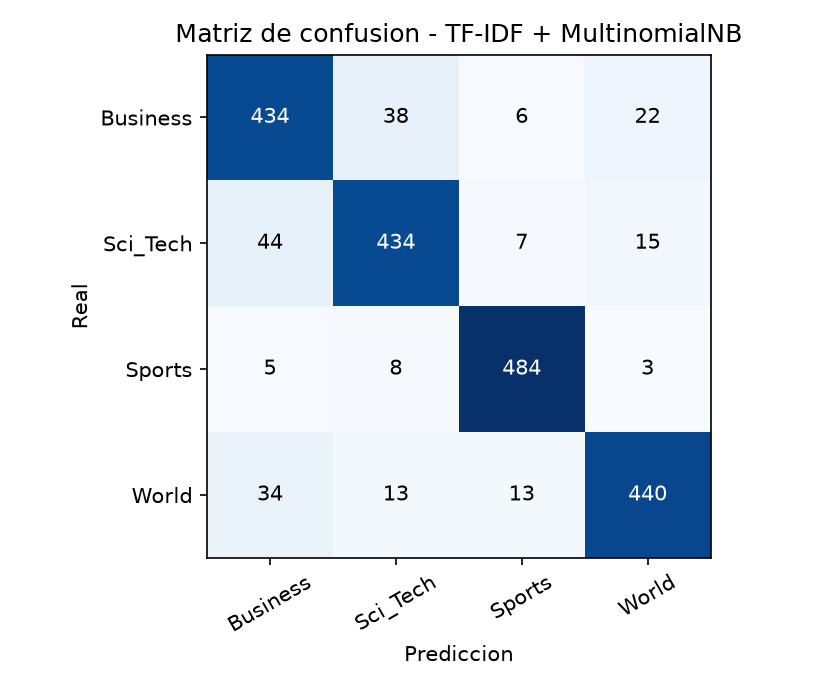

# Pre-entrega 3 - Clasificador supervisado con TF-IDF (AG News)

Baseline clasico para el proyecto de Data Science III: texto crudo -> preprocesamiento (Modulo 2) -> TF-IDF -> clasificador.

## Contenido
- `M3_clasificador_tfidf.ipynb`: pipeline completo y comentado.
- `proy_datasc_tp_mlg.py`: funciones de preprocesamiento del Modulo 2 (limpieza Regex, normalizacion y lematizacion).
- `data/`: `ag_news_train.csv` (8.000) y `ag_news_test.csv` (2.000).
- `requirements.txt`: versiones usadas.

## Datos y ausencia de data leakage
Se usan los splits provistos. El `TfidfVectorizer` se ajusta (`fit_transform`) **solo con train** y se aplica `transform` al test. La eleccion de
hiperparametros y modelo se hizo en una validacion del 20% tomada del train; el test se uso una unica vez al final.
Preprocesamiento: limpieza Regex (entidades HTML, tags, URLs, firmas de agencia), minusculas y lematizacion con **spaCy en_core_web_sm**.

## Parametros del vectorizador (elegidos por validacion)
| Parametro | Valor | Motivo |
|---|---|---|
| max_features | sin limite | limita el vocabulario a los terminos mas frecuentes y reduce overfitting y memoria |
| ngram_range | (1, 2) | incluye bigramas para capturar contexto local (p. ej. "new york", "oil price") |
| sublinear_tf | True | amortigua terminos que se repiten muchas veces en un documento |
| min_df | 2 | descarta terminos que aparecen en un unico documento (ruido y errores tipograficos) |
| stop_words | english | reduce el tamano de la matriz sin perder senal tematica |

Vocabulario resultante: 25,400 terminos. Mejores configuraciones en validacion (F1 macro):

| max_features | ngram_range | modelo | n_features | F1 macro val. |
|---|---|---|---|---|
| sin limite | (1, 2) | MultinomialNB | 20507 | 0.8960 |
| 20000 | (1, 2) | MultinomialNB | 20000 | 0.8954 |
| sin limite | (1, 2) | LinearSVC | 20507 | 0.8934 |
| 20000 | (1, 1) | MultinomialNB | 8253 | 0.8929 |
| sin limite | (1, 1) | MultinomialNB | 8253 | 0.8929 |
| 20000 | (1, 2) | LinearSVC | 20000 | 0.8921 |
| 5000 | (1, 1) | MultinomialNB | 5000 | 0.8914 |
| 5000 | (1, 2) | MultinomialNB | 5000 | 0.8907 |

## Justificacion del modelo
Se compararon Naive Bayes, Regresion Logistica y SVM lineal con la misma grilla de vectorizacion. Mejor F1 macro de validacion por modelo:

| Modelo | F1 macro (val.) |
|---|---|
| MultinomialNB | 0.8960 |
| LinearSVC | 0.8934 |
| LogisticRegression | 0.8891 |

Se eligio **MultinomialNB** por obtener el mejor F1 macro en validacion. Naive Bayes multinomial modela conteos/pesos de palabras asumiendo independencia condicional; es muy rapido, trabaja directo sobre la matriz esparsa y suele rendir bien en clasificacion tematica de textos cortos.
Entrenamiento sobre el train completo: 0.17 s en CPU.

## Resultados sobre el test
F1 macro = **0.8960** | Accuracy = **0.8960** (las 4 clases estan balanceadas: 500 documentos por clase en test, por lo que macro y weighted coinciden).

| Clase | Precision | Recall | F1 |
|---|---|---|---|
| Business | 0.8395 | 0.8680 | 0.8535 |
| Sci_Tech | 0.8803 | 0.8680 | 0.8741 |
| Sports | 0.9490 | 0.9680 | 0.9584 |
| World | 0.9167 | 0.8800 | 0.8980 |



## Analisis preliminar: categorias mas dificiles
Segun la matriz de confusion, la categoria mas dificil es **Business** (F1 = 0.853) y la mas facil es **Sports** (F1 = 0.958).
Confusiones mas frecuentes (real -> predicho):

- **Sci_Tech -> Business**: 44 documentos
- **Business -> Sci_Tech**: 38 documentos
- **World -> Business**: 34 documentos

Terminos mas influyentes por categoria:

- **Business**: say, oil, price, company, new, profit
- **Sci_Tech**: microsoft, new, say, software, internet, company
- **Sports**: win, game, season, team, night, cup
- **World**: say, iraq, kill, president, minister, election

La confusion mas frecuente es **Sci_Tech -> Business** (44 documentos). Es esperable en un modelo de bolsa de palabras: TF-IDF no captura el contexto ni el orden de las palabras,
por lo que las categorias que comparten vocabulario se separan peor. Esa limitacion es la que se busca mejorar con el Transformer + LoRA del Modulo 4.

## Como reproducir
```
pip install -r requirements.txt
python -m spacy download en_core_web_sm
jupyter notebook M3_clasificador_tfidf.ipynb   # Run All
```
